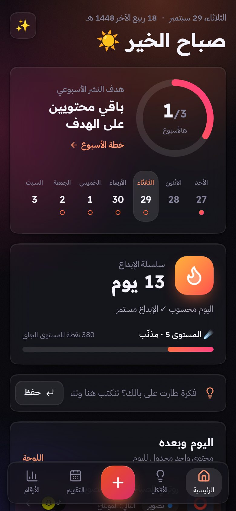
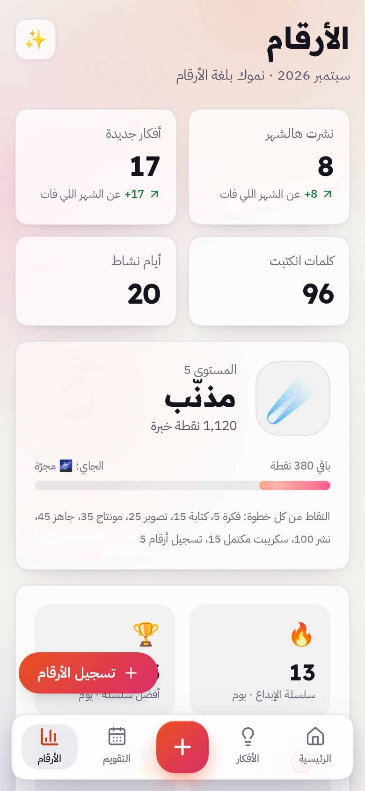
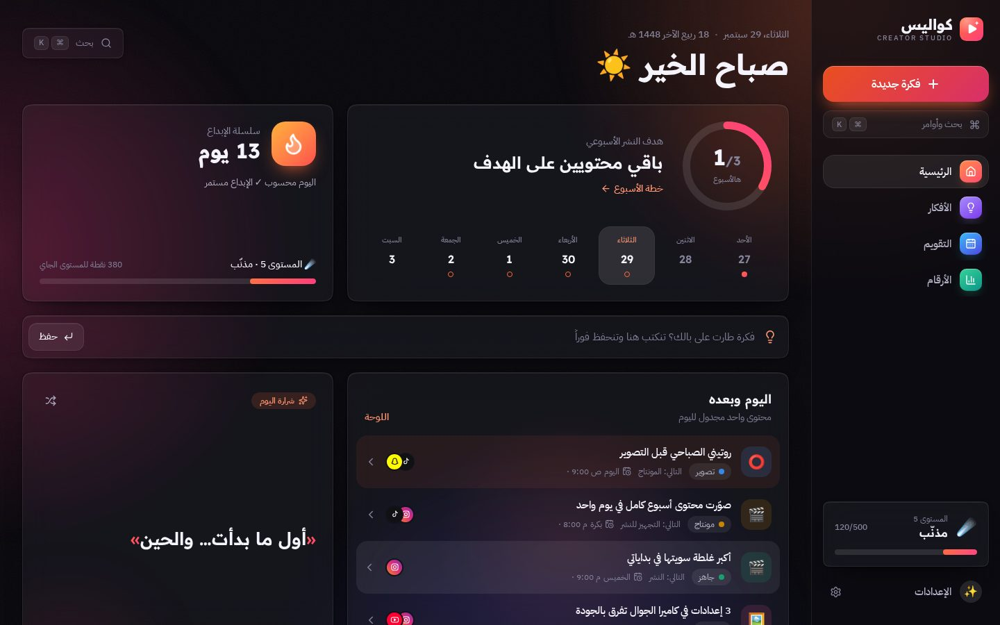

# كواليس

**استوديو صانع المحتوى: من الفكرة إلى النشر، في مكان واحد**

By: **Eng.Reem Alfadly**

### ⬇️ تحميل البرنامج

[**ويندوز**](https://github.com/reemalfadly/kawalees/releases/latest/download/Kawalees-Windows-Setup.exe) ·
[**ماك**](https://github.com/reemalfadly/kawalees/releases/latest/download/Kawalees-Mac.dmg) ·
[**أندرويد**](https://github.com/reemalfadly/kawalees/releases/latest/download/Kawalees-Android.apk) ·
[**لينكس**](https://github.com/reemalfadly/kawalees/releases/latest/download/Kawalees-Linux.AppImage)

أو [**فتحه من المتصفح**](https://reemalfadly.github.io/kawalees/) بدون تحميل (والطريقة الوحيدة للآيفون والآيباد)

مجاني · بالعربي · يشتغل بدون إنترنت · بياناتك على جهازك وبس

  
  
  

  

---

## شنو كواليس؟

تطبيق يجمع شغل صانع المحتوى كله: **الأفكار، والسكريبتات، وجدول النشر، والأرقام**.

- **بنك الأفكار:** تسجيل أي فكرة بثانية، وبحث يفهم الكتابة العربية بأي شكل (أداة = اداة).
- **لوحة المراحل:** فكرة ← كتابة ← تصوير ← مونتاج ← جاهز ← منشور، والبطاقات تنسحب بين المراحل.
- **محرر السكريبت:** خطّاف، ومحتوى، ودعوة للتفاعل، مع قوالب جاهزة وحساب مدة الكلام.
- **وضع التصوير (تيليبرومبتر):** السكريبت ينزل على الشاشة وقت التصوير، بسرعة ثابتة أو **يتبع الصوت** مع كل كلمة تنقال (كروم وسفاري).
- **التقويم:** جدول النشر الشهري بالسحب والإفلات.
- **الأرقام:** نمو المتابعين، والنشر الأسبوعي، وسلسلة أيام الإبداع، والمستويات، و12 إنجاز.
- **ملخص الشهر:** قصة بشكل ستوري جاهزة للمشاركة.
- **وضع داكن وفاتح**، وخمسة ألوان للتطبيق.

---

## تحميل البرنامج على الجهاز

كواليس **برنامج كامل** ينزل على الجهاز ويفتح من سطح المكتب أو قائمة التطبيقات، ويشتغل بدون إنترنت.

| الجهاز                         | التحميل                                                                                                                   | أول تشغيل                                                                                                  |
| ------------------------------ | ------------------------------------------------------------------------------------------------------------------------- | ---------------------------------------------------------------------------------------------------------- |
| 🪟 ويندوز 10 و 11              | [Kawalees-Windows-Setup.exe](https://github.com/reemalfadly/kawalees/releases/latest/download/Kawalees-Windows-Setup.exe) | فتح الملف وإكمال التثبيت. إذا طلع تنبيه «Windows protected your PC»: **More info ← Run anyway**            |
| 🍎 ماك (Apple Silicon و Intel) | [Kawalees-Mac.dmg](https://github.com/reemalfadly/kawalees/releases/latest/download/Kawalees-Mac.dmg)                     | فتح الملف وسحب Kawalees إلى **Applications**. أول مرة: **إعدادات النظام ← الخصوصية والأمان ← Open Anyway** |
| 🤖 أندرويد                     | [Kawalees-Android.apk](https://github.com/reemalfadly/kawalees/releases/latest/download/Kawalees-Android.apk)             | فتح الملف من الجوال، والسماح بالتثبيت من هذا المصدر لما يطلب                                               |
| 🐧 لينكس                       | [Kawalees-Linux.AppImage](https://github.com/reemalfadly/kawalees/releases/latest/download/Kawalees-Linux.AppImage)       | خصائص الملف ← السماح بالتشغيل، ثم فتحه                                                                     |
| 📱 آيفون وآيباد                | من المتصفح (تحت)                                                                                                          | Apple ما تسمح بتحميل برامج من خارج App Store، فالتثبيت يكون من Safari                                      |

> التنبيهات اللي تطلع أول مرة في ويندوز وماك طبيعية لأي برنامج جديد من خارج المتاجر، وتطلع مرة وحدة بس.
> كل الإصدارات في صفحة [Releases](https://github.com/reemalfadly/kawalees/releases).

**ملاحظة:** وضع التصوير «يتبع الصوت» يشتغل في نسخة المتصفح (Chrome و Safari). في البرنامج المحمّل، وضع التصوير يشتغل بالسرعة الثابتة.

---

## التثبيت من المتصفح

طريقة ثانية بدون تحميل أي ملف: كواليس **تطبيق ويب قابل للتثبيت (PWA)**.
يتثبت من المتصفح بدقيقة، وبعدها يفتح من الشاشة الرئيسية مثل أي تطبيق، بنافذة خاصة فيه وبدون شريط المتصفح.

**الرابط:** https://reemalfadly.github.io/kawalees/

### 📱 آيفون وآيباد (iOS / iPadOS)

1. فتح الرابط من متصفح **Safari**.
2. الضغط على زر **المشاركة** (مربع وسهم لفوق): في الآيفون تحت الشاشة، وفي الآيباد فوق.
3. اختيار **«إضافة إلى الشاشة الرئيسية»** (Add to Home Screen) ثم **«إضافة»**.
4. أيقونة كواليس تطلع مع التطبيقات ✅

> من iOS 16.4 وأحدث، نفس الخطوات تنفع من Chrome و Edge على الآيفون والآيباد.

### 🤖 أندرويد (جوال أو تابلت)

1. فتح الرابط من متصفح **Chrome**.
2. يطلع اقتراح **«تثبيت التطبيق»** تحت الشاشة، أو من القائمة **⋮** فوق.
3. اختيار **«تثبيت التطبيق»** (Install app) ثم **«تثبيت»**.
4. كواليس ينضاف لقائمة التطبيقات والشاشة الرئيسية ✅

> في **Samsung Internet** و **Edge**: القائمة ← «إضافة إلى الشاشة الرئيسية».

### 🪟 ويندوز (لابتوب أو ديسكتوب)

1. فتح الرابط في **Microsoft Edge** أو **Google Chrome**.
2. الضغط على **أيقونة التثبيت** في شريط العنوان (شاشة فيها سهم ⊕).
3. أو من القائمة **(…)** ← **التطبيقات** ← **«تثبيت هذا الموقع كتطبيق»**.
4. كواليس يطلع في **قائمة ابدأ**، ويتثبت على **شريط المهام** ✅

> للحذف: قائمة ابدأ ← زر يمين على كواليس ← **إلغاء التثبيت**.

### 🍎 ماك (MacBook و iMac)

1. فتح الرابط في **Safari** (نظام macOS Sonoma أو أحدث).
2. من قائمة **File** اختيار **«Add to Dock»**.
3. أو في **Chrome** و **Edge**: أيقونة التثبيت في شريط العنوان.
4. كواليس يطلع في الـ **Dock** و **Launchpad** ✅

### 🐧 لينكس وكروم بوك

نفس خطوات ويندوز من **Chrome** أو **Edge** أو **Chromium**.

> 💡 نفس الشرح موجود داخل التطبيق: **الإعدادات ← تثبيت التطبيق**، ويفتح على نوع الجهاز تلقائياً.

---

## أسئلة شائعة

**هل التطبيق مجاني؟**

- نعم، بالكامل، وبدون حساب ولا تسجيل دخول.

**وين تنحفظ البيانات؟**

- على الجهاز نفسه فقط (داخل المتصفح). ما في سيرفر، وما يطلع شي من الجهاز.

**يشتغل بدون إنترنت؟**

- نعم. بعد أول فتح، التطبيق كله ينحفظ على الجهاز ويشتغل حتى في وضع الطيران.

**كيف ينقل الشغل من جهاز لجهاز؟**

- الإعدادات ← **تصدير نسخة** (ينزل ملف صغير).
- في الجهاز الثاني: الإعدادات ← **استيراد نسخة** ← اختيار الملف.

**كيف يتحدث التطبيق؟**

- تلقائياً. لما تنزل نسخة جديدة يطلع تنبيه صغير فيه زر **«تحديث»**.

**لو انحذف التطبيق، تروح البيانات؟**

- حذف التطبيق أو مسح بيانات المتصفح يمسح البيانات. عشان كذا ننصح بـ **تصدير نسخة** بين فترة وفترة.
- التطبيق نفسه ياخذ نسخة احتياطية يومية داخل الجهاز (آخر 10 نسخ)، والاسترجاع من **الإعدادات ← البيانات والحماية ← النسخ التلقائية**.

**شنو المتصفحات المدعومة؟**

- Safari 16.4+، و Chrome و Edge و Samsung Internet (آخر إصدارين)، و Firefox (بدون خاصية التثبيت على الكمبيوتر).

---

## الرخصة والحقوق

كواليس **مجاني للاستخدام** على أي عدد من الأجهزة، للاستخدام الشخصي أو المهني.

- © 2026 **Eng.Reem Alfadly**. جميع الحقوق محفوظة.
- ممنوع بيع البرنامج، أو إعادة نشره أو نسخه أو تعديله باسم آخر، بدون إذن مكتوب.
- مشاركة رابط هذي الصفحة مرحب فيها.
- النص الكامل في ملف [LICENSE](LICENSE).
