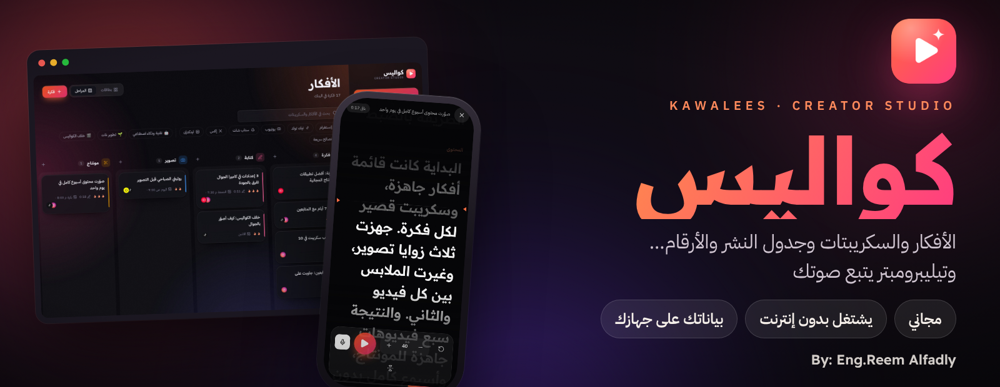
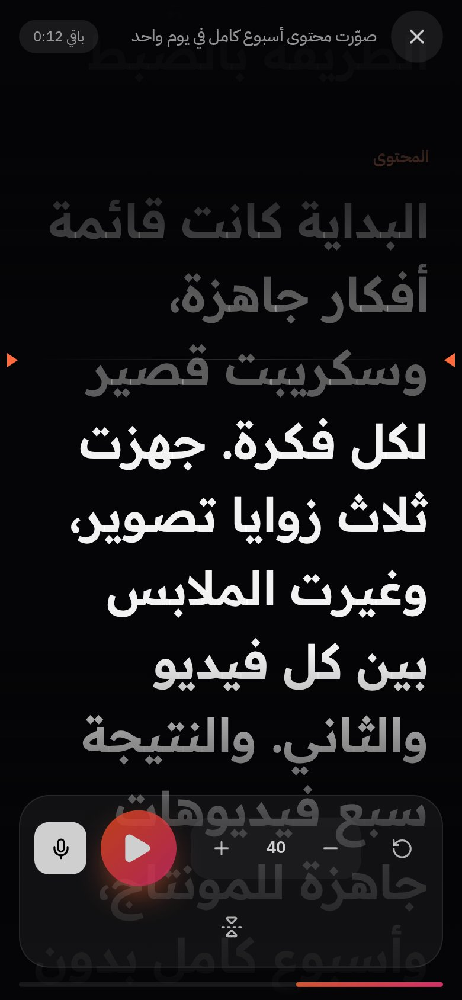
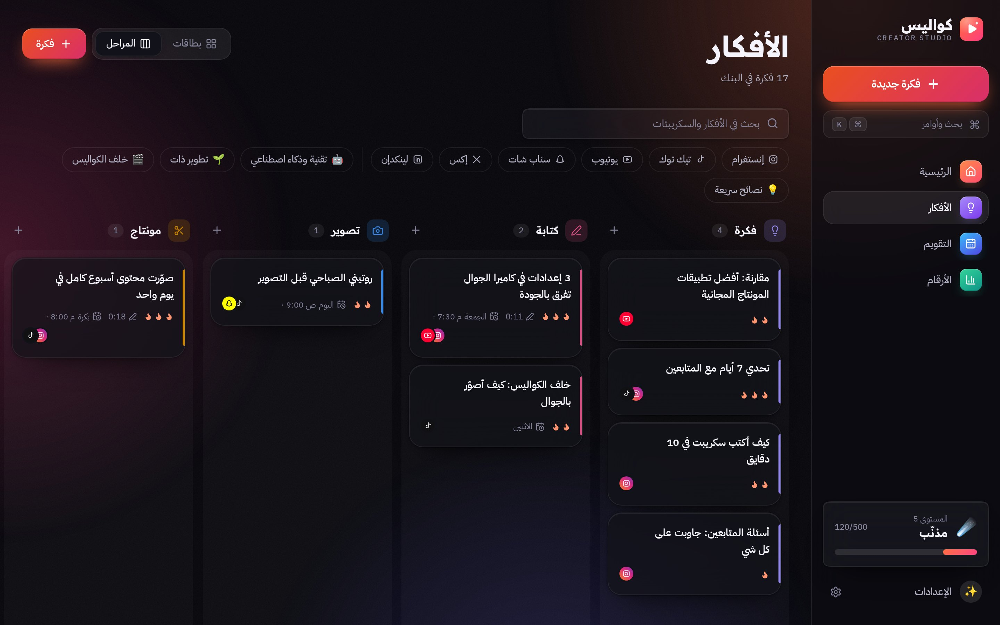
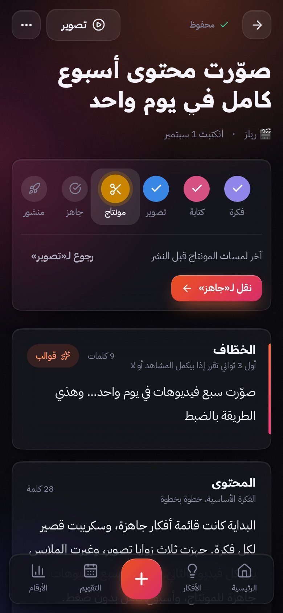
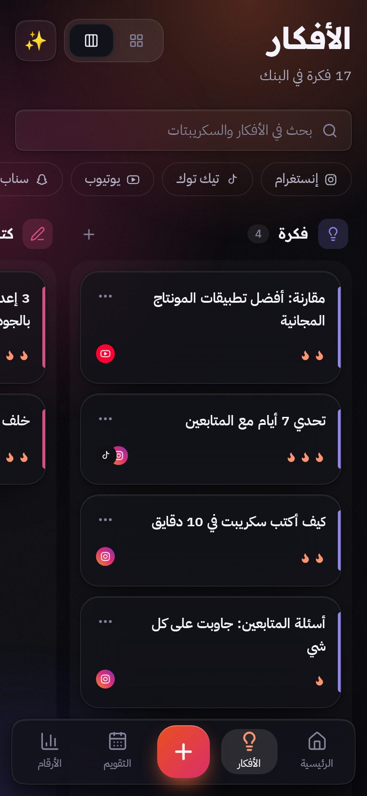
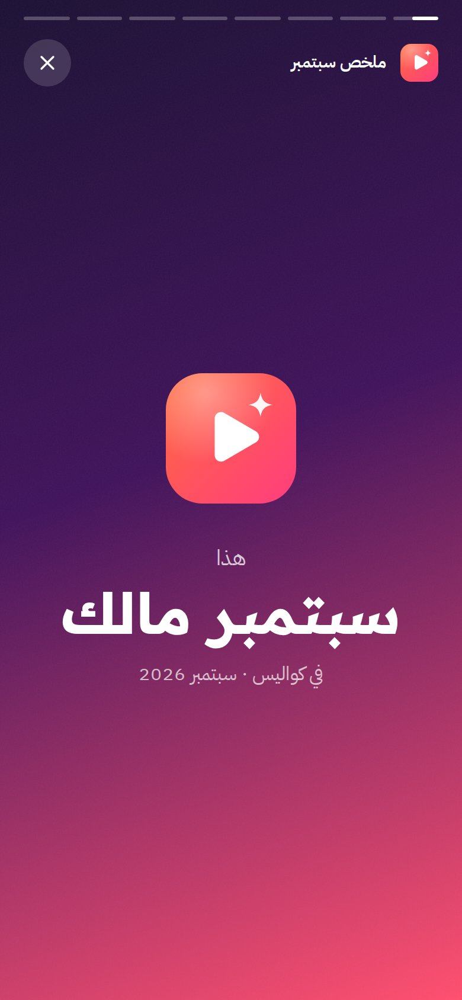
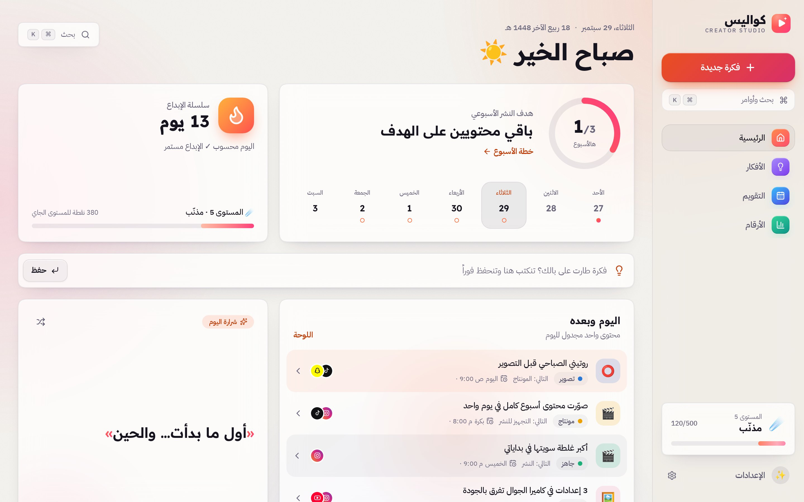
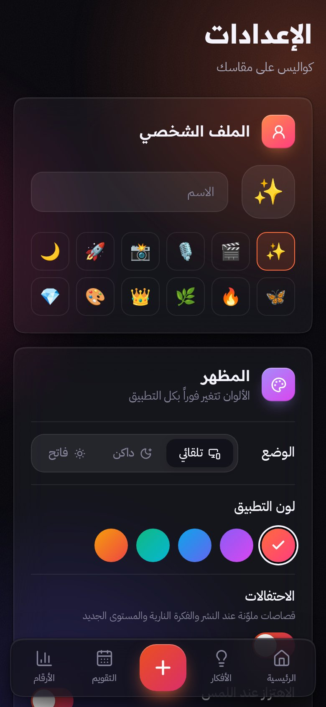

<div align="center">



<br>

[](https://github.com/reemalfadly/kawalees/releases/latest)
[](#-الرخصة-والحقوق)
[](#-تحميل-البرنامج)
[](#-أسئلة-شائعة)

# كواليس

### استوديو صانع المحتوى: من الفكرة إلى النشر، في مكان واحد

الأفكار · السكريبتات · جدول النشر · الأرقام · **وتيليبرومبتر يتبع صوتك**

**By: Eng.Reem Alfadly**

<br>

### ⬇️ تحميل البرنامج

<a href="https://github.com/reemalfadly/kawalees/releases/latest/download/Kawalees-Windows-Setup.exe"></a>
<a href="https://github.com/reemalfadly/kawalees/releases/latest/download/Kawalees-Mac.dmg"></a>
<a href="https://github.com/reemalfadly/kawalees/releases/latest/download/Kawalees-Android.apk"></a>
<a href="https://github.com/reemalfadly/kawalees/releases/latest/download/Kawalees-Linux.AppImage"></a>

<br>

📱 **آيفون وآيباد، أو بدون تحميل:** [افتحه من المتصفح](https://reemalfadly.github.io/kawalees/) وثبّته على الشاشة الرئيسية

</div>

---

## 🎙️ المزايا الأبرز: شاشة المذيعين اللي تسمعك

<table>
<tr>
<td width="62%" valign="top">

المذيع ما يحفظ ولا كلمة: **الكلام يمشي قدامه وهو يقرأ.**
هذي الشاشة صارت بكواليس، بدون شراء شاشة ثانية.

- 🗣️ **يتبع صوتك:** القراءة بصوت عالٍ، والسكريبت يمشي معها كلمة كلمة.
- ⏸️ **يقف لما الصوت يقف**، ويكمل لما ترجع القراءة.
- ✨ **الكلمة الحالية تضوي** والكلمات اللي انقالت تبهت.
- 🎚️ بدائل جاهزة: **سرعة ثابتة**، وحجم الخط، ووضع المرآة.
- 🎬 مصمم لوقت تصوير الريلز والفيديوهات.

> **ملاحظة صدق:** «يتبع الصوت» يشتغل في **Chrome و Safari** (نسخة المتصفح)، ويحتاج إنترنت وإذن المايكروفون. في البرنامج المحمّل، وضع التصوير يشتغل بالسرعة الثابتة.

</td>
<td width="38%" align="center">

</td>
</tr>
</table>

---

## ✨ كل شغل صانع المحتوى في مكان واحد

<table>
<tr>
<td width="50%" valign="top">

### 💡 بنك الأفكار

تسجيل أي فكرة بثانية. بحث يفهم الكتابة العربية بأي شكل (أداة = اداة).

</td>
<td width="50%" valign="top">

### 🗂️ لوحة المراحل

فكرة ← كتابة ← تصوير ← مونتاج ← جاهز ← منشور، والبطاقات تنسحب بين المراحل.

</td>
</tr>
<tr>
<td valign="top">

### ✍️ محرر السكريبت

خطّاف، ومحتوى، ودعوة للتفاعل، مع قوالب جاهزة وحساب مدة الكلام.

</td>
<td valign="top">

### 📅 التقويم

جدول النشر الشهري بالسحب والإفلات.

</td>
</tr>
<tr>
<td valign="top">

### 📈 الأرقام والإنجازات

نمو المتابعين، والنشر الأسبوعي، وسلسلة أيام الإبداع، ومستويات و12 إنجاز.

</td>
<td valign="top">

### 🎞️ ملخص الشهر

قصة بشكل ستوري جاهزة للمشاركة.

</td>
</tr>
<tr>
<td valign="top">

### 🎨 ألوان ووضعين

وضع داكن وفاتح، وخمسة ألوان للتطبيق.

</td>
<td valign="top">

### 🔒 خصوصية كاملة

بياناتك على جهازك فقط. بدون حساب، وبدون سيرفر، وبدون تتبع.

</td>
</tr>
</table>

---

## 🖼️ لقطات من البرنامج

<p align="center">
  
</p>

<p align="center">
  
  
  
  
  
</p>

<p align="center">
  
  
</p>

---

## 📥 تحميل البرنامج

كواليس **برنامج كامل** ينزل على الجهاز ويفتح من سطح المكتب أو قائمة التطبيقات، ويشتغل بدون إنترنت.

| الجهاز                         | التحميل                                                                                                                   | أول تشغيل                                                                                                  |
| ------------------------------ | ------------------------------------------------------------------------------------------------------------------------- | ---------------------------------------------------------------------------------------------------------- |
| 🪟 ويندوز 10 و 11              | [Kawalees-Windows-Setup.exe](https://github.com/reemalfadly/kawalees/releases/latest/download/Kawalees-Windows-Setup.exe) | فتح الملف وإكمال التثبيت. إذا طلع تنبيه «Windows protected your PC»: **More info ← Run anyway**            |
| 🍎 ماك (Apple Silicon و Intel) | [Kawalees-Mac.dmg](https://github.com/reemalfadly/kawalees/releases/latest/download/Kawalees-Mac.dmg)                     | فتح الملف وسحب Kawalees إلى **Applications**. أول مرة: **إعدادات النظام ← الخصوصية والأمان ← Open Anyway** |
| 🤖 أندرويد                     | [Kawalees-Android.apk](https://github.com/reemalfadly/kawalees/releases/latest/download/Kawalees-Android.apk)             | فتح الملف من الجوال، والسماح بالتثبيت من هذا المصدر لما يطلب                                               |
| 🐧 لينكس                       | [Kawalees-Linux.AppImage](https://github.com/reemalfadly/kawalees/releases/latest/download/Kawalees-Linux.AppImage)       | خصائص الملف ← السماح بالتشغيل، ثم فتحه                                                                     |
| 📱 آيفون وآيباد                | من المتصفح (تحت)                                                                                                          | Apple ما تسمح بتحميل برامج من خارج App Store، فالتثبيت يكون من Safari                                      |

> التنبيهات اللي تطلع أول مرة في ويندوز وماك طبيعية لأي برنامج جديد من خارج المتاجر، وتطلع مرة وحدة بس.
> كل الإصدارات في صفحة [Releases](https://github.com/reemalfadly/kawalees/releases).

### 🔐 التحقق من أصل الملف

كل ملف تحميل له **توقيع بناء مشفر** من GitHub (Attestation) يثبت إنه انبنى من هذا المستودع. للتحقق (من الإصدار 1.4.0 وطالع):

```
gh attestation verify Kawalees-Windows-Setup.exe --repo reemalfadly/kawalees
```

---

## 🌐 التثبيت من المتصفح

طريقة ثانية بدون تحميل أي ملف: كواليس **تطبيق ويب قابل للتثبيت (PWA)**.
يتثبت من المتصفح بدقيقة، وبعدها يفتح من الشاشة الرئيسية مثل أي تطبيق، بنافذة خاصة فيه وبدون شريط المتصفح.

**الرابط:** https://reemalfadly.github.io/kawalees/

### 📱 آيفون وآيباد (iOS / iPadOS)

1. فتح الرابط من متصفح **Safari**.
2. الضغط على زر **المشاركة** (مربع وسهم لفوق): في الآيفون تحت الشاشة، وفي الآيباد فوق.
3. اختيار **«إضافة إلى الشاشة الرئيسية»** (Add to Home Screen) ثم **«إضافة»**.
4. أيقونة كواليس تطلع مع التطبيقات ✅

> من iOS 16.4 وأحدث، نفس الخطوات تنفع من Chrome و Edge على الآيفون والآيباد.

### 🤖 أندرويد (جوال أو تابلت)

1. فتح الرابط من متصفح **Chrome**.
2. يطلع اقتراح **«تثبيت التطبيق»** تحت الشاشة، أو من القائمة **⋮** فوق.
3. اختيار **«تثبيت التطبيق»** (Install app) ثم **«تثبيت»**.
4. كواليس ينضاف لقائمة التطبيقات والشاشة الرئيسية ✅

> في **Samsung Internet** و **Edge**: القائمة ← «إضافة إلى الشاشة الرئيسية».

### 🪟 ويندوز (لابتوب أو ديسكتوب)

1. فتح الرابط في **Microsoft Edge** أو **Google Chrome**.
2. الضغط على **أيقونة التثبيت** في شريط العنوان (شاشة فيها سهم ⊕).
3. أو من القائمة **(…)** ← **التطبيقات** ← **«تثبيت هذا الموقع كتطبيق»**.
4. كواليس يطلع في **قائمة ابدأ**، ويتثبت على **شريط المهام** ✅

> للحذف: قائمة ابدأ ← زر يمين على كواليس ← **إلغاء التثبيت**.

### 🍎 ماك (MacBook و iMac)

1. فتح الرابط في **Safari** (نظام macOS Sonoma أو أحدث).
2. من قائمة **File** اختيار **«Add to Dock»**.
3. أو في **Chrome** و **Edge**: أيقونة التثبيت في شريط العنوان.
4. كواليس يطلع في الـ **Dock** و **Launchpad** ✅

### 🐧 لينكس وكروم بوك

نفس خطوات ويندوز من **Chrome** أو **Edge** أو **Chromium**.

> 💡 نفس الشرح موجود داخل التطبيق: **الإعدادات ← تثبيت التطبيق**، ويفتح على نوع الجهاز تلقائياً.

---

---

## ❓ أسئلة شائعة

**هل التطبيق مجاني؟**

- نعم، بالكامل، وبدون حساب ولا تسجيل دخول.

**وين تنحفظ البيانات؟**

- على الجهاز نفسه فقط (داخل المتصفح). ما في سيرفر، وما يطلع شي من الجهاز.

**يشتغل بدون إنترنت؟**

- نعم. بعد أول فتح، التطبيق كله ينحفظ على الجهاز ويشتغل حتى في وضع الطيران.

**كيف ينقل الشغل من جهاز لجهاز؟**

- الإعدادات ← **تصدير نسخة** (ينزل ملف صغير).
- في الجهاز الثاني: الإعدادات ← **استيراد نسخة** ← اختيار الملف.

**كيف يتحدث التطبيق؟**

- تلقائياً. لما تنزل نسخة جديدة يطلع تنبيه صغير فيه زر **«تحديث»**.

**لو انحذف التطبيق، تروح البيانات؟**

- حذف التطبيق أو مسح بيانات المتصفح يمسح البيانات. عشان كذا ننصح بـ **تصدير نسخة** بين فترة وفترة.
- التطبيق نفسه ياخذ نسخة احتياطية يومية داخل الجهاز (آخر 10 نسخ)، والاسترجاع من **الإعدادات ← البيانات والحماية ← النسخ التلقائية**.

**شنو المتصفحات المدعومة؟**

- Safari 16.4+، و Chrome و Edge و Samsung Internet (آخر إصدارين)، و Firefox (بدون خاصية التثبيت على الكمبيوتر).

---

---

## 📜 الرخصة والحقوق

كواليس **مجاني للاستخدام** على أي عدد من الأجهزة، للاستخدام الشخصي أو المهني.

- © 2026 **Eng.Reem Alfadly**. جميع الحقوق محفوظة.
- ممنوع بيع البرنامج، أو إعادة نشره أو نسخه أو تعديله باسم آخر، بدون إذن مكتوب.
- مشاركة رابط هذي الصفحة مرحب فيها.
- النص الكامل في ملف [LICENSE](LICENSE).

<div align="center">

<br>

**كواليس** · By: **Eng.Reem Alfadly**

</div>
